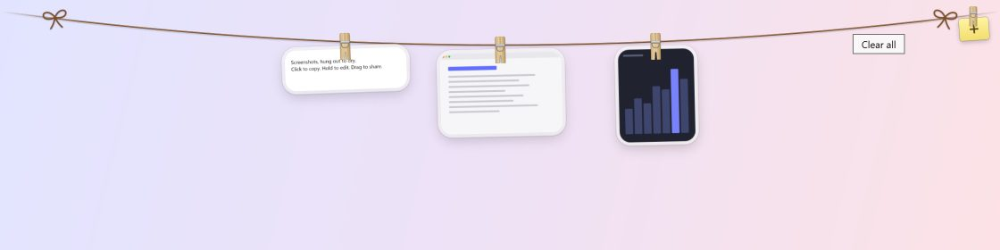

<a href="README.md">English</a> · <a href="README.zh-CN.md">简体中文</a>

<h1 align="center">Snapline</h1>

<strong>把截图挂在桌面顶部，随手就能用。</strong> 截图后直接复制、标注或拖进正在用的应用。

  

  
  
  · <a href="#快速上手">快速上手</a> · <a href="https://github.com/pasariga/snapline/issues/new/choose">问题反馈</a>

*由本 Windows 修改版使用示例图渲染。[观看上游演示](docs/demo.mp4)。*

上课截了几页课件，写报告要贴图，或者聊天时想发刚刚截到的画面？Snapline 会把新截图自动挂到桌面顶部的“晾衣杆”上。把鼠标移到屏幕顶边，截图就能随手复制或拖走，少开一次资源管理器。

## 你可以用它做什么

这些功能来自[上游 Snapline](https://github.com/mohabujubara/snapline)。

- **收集截图。** 用 Windows 截图工具或你习惯的工具。Snapline 监视 Windows 截图文件夹，也可以接收复制到剪贴板的图片。其他截图目录可在设置里添加。
- **复制、拖拽和整理。** 单击卡片复制图片，直接拖到支持的应用或文件夹，也可以在晾衣杆上重新排列截图。菜单里还能新建便签。
- **标注和识字。** 按住截图卡片开始标注，或右键选 **Copy text** 用 Windows OCR 提取文字。可用的识别语言取决于 Windows。

## 这个 Windows 修改版改了什么

- **截图飞入和面板动画**采用 Windows 合成器渲染，并提供回退路径。动画预览与原截图分开处理。
- **操作时晾衣杆会等你。** 拖拽、编辑和打开菜单期间，自动收起倒计时会暂停。完成操作并移开鼠标后重新计时。可在设置里调到 **0.5～30 秒**，默认 **2.5 秒**。
- **区分最大化窗口和全屏应用。** 普通窗口最大化后仍可唤出晾衣杆。

原始修改、动画配置时长和截图回收细节见 [Windows 实现说明](docs/WINDOWS-CHANGES.md)。

## 快速上手

1. 打开 [Windows 下载页](https://github.com/pasariga/snapline/releases)。选 **Setup.exe** 安装版可获得开始菜单入口和卸载程序，选 **Portable.exe** 便携版可直接运行。两种 Windows x64 构建都自带 .NET 运行时。发行页暂时为空时，可[从源码构建](LOCAL-DEVELOPMENT.md)。
2. 从开始菜单或便携文件启动，Snapline 会驻留在系统托盘。
3. 按 **Win+Shift+S** 截一张图，再把鼠标移到屏幕顶边唤出晾衣杆。也可以点击托盘图标或按 **Ctrl+Alt+T**。
4. 单击复制、按住标注、双击打开，或者把截图拖到需要用图的地方。

此版本面向 Windows 11 和 Windows 10 x64（1809 或更新版本）。安装版和便携版均未进行代码签名，Windows 可能显示未知发布者或 SmartScreen 提示。发行说明会列出文件和 SHA-256 校验方法。

## 本地存储与截图保留

截图处理与 OCR 均在本地完成，无需账号或 API Key。安装版和便携版默认都将设置、日志和托管截图保存到 `%LOCALAPPDATA%\Snapline Windows`。如果选择监视本来就在同步的文件夹，Windows 或第三方工具仍可能同步该文件夹。

**要长期保留的截图和便签，请另存到托管目录之外。** Windows 开始新的登录会话，或本地日期变化时，晾衣杆会清空。Snapline 核对归属记录、路径和文件哈希后，可能会把符合条件的托管截图移入回收站。外部文件和已被替换的文件不在此自动回收范围内。

## 常见问题

| 问题 | 处理方式 |
| --- | --- |
| 为什么截完没有出现？ | 检查设置里的剪贴板图片接收开关，或把截图工具的保存目录加进监视列表。若关闭顶边唤出，用托盘图标或 **Ctrl+Alt+T** 打开。 |
| 动画会压缩原截图吗？ | 动画使用独立预览。复制和打开读取源图，标注后也可以恢复原图。 |
| 能保留我现有的 Snapline 吗？ | 可以。这个版本有独立的安装项和数据目录，原设置留在原目录。建议每次只运行一个版本，以免快捷键和剪贴板监听冲突。 |
| 软件界面支持中文吗？ | 仓库有中英文说明，软件界面目前提供英语和阿拉伯语。 |
| 有 macOS 版吗？ | 仓库保留上游 macOS 源码，本修改版提供 Windows x64 安装包。 |

## 反馈和贡献

欢迎[反馈问题或提出功能建议](https://github.com/pasariga/snapline/issues/new/choose)，也可以查看[贡献指南](CONTRIBUTING.md#中文)。如果 Snapline 让你处理截图更顺手，欢迎给仓库点一颗 Star，让更多需要它的人找到它。

## 项目来源与许可证

这是 pasariga 独立维护的 Windows 修改版，基于 **Mohammed Abu Jubara 及贡献者**开发的 [Snapline](https://github.com/mohabujubara/snapline)，该项目源于 **Alejandro Buján Pampín** 的 [Tendedero](https://github.com/alejandrobujan/tendedero)。晾衣杆概念、继承功能、Logo、界面图和演示素材归功于相应的上游作者。

Snapline 免费开源，遵循 [MIT 许可证](LICENSE)。Manrope 字体遵循 [SIL 开放字体许可证](src/Snapline/Assets/Fonts/OFL.txt)，[设计素材](design/fonts/OFL.txt)也附有相同的字体授权。
